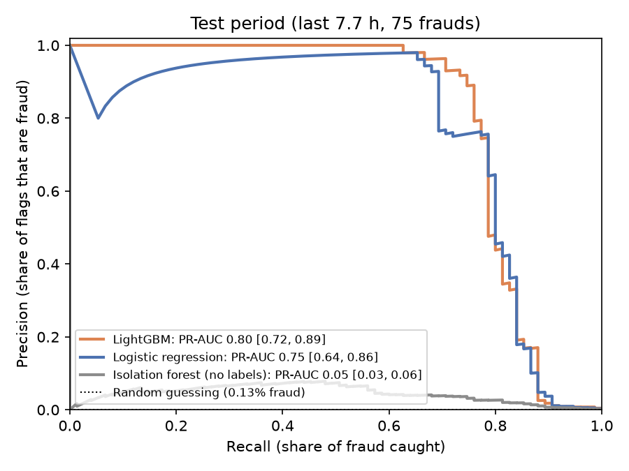
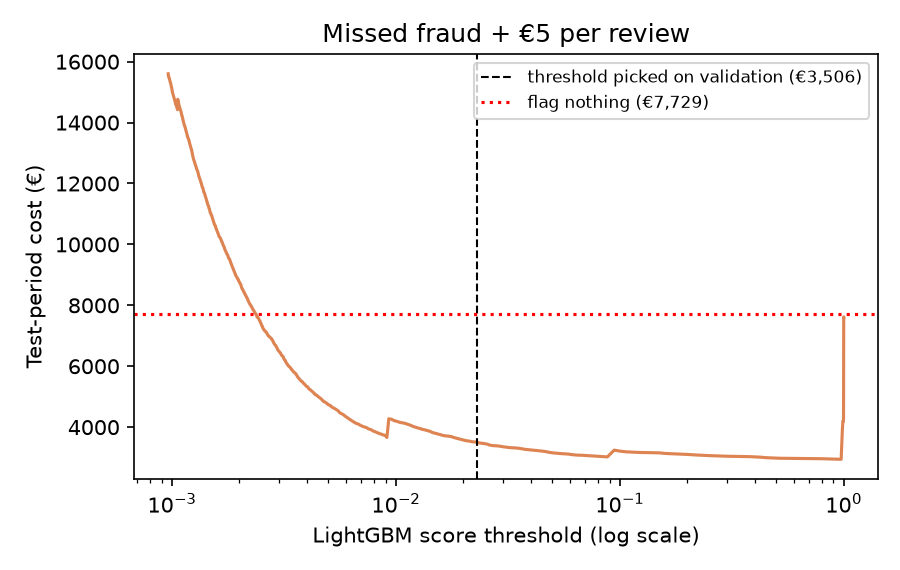
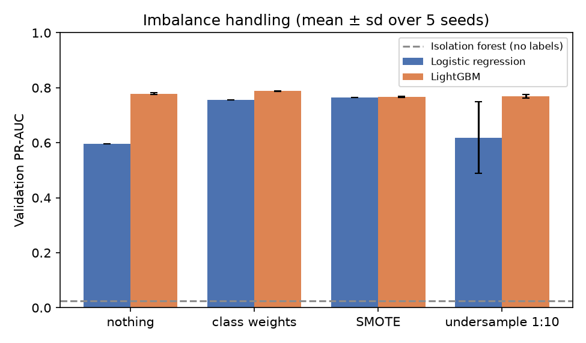
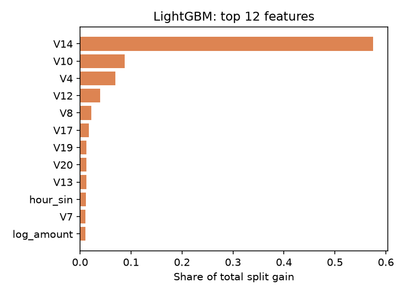

# Credit-card fraud detection, evaluated honestly

Trained model: [nipuna02/credit-card-fraud-lightgbm](https://huggingface.co/nipuna02/credit-card-fraud-lightgbm) on Hugging Face.

Fraud is 0.17% of transactions in this dataset. A model that says "never fraud" is 99.8% accurate, so accuracy and
ROC-AUC say very little here. This project trains fraud detectors on the ULB credit-card dataset and evaluates them
the way a bank would use them:

- **Split by time, not at random.** The model learns from the first 60% of transactions, the threshold is chosen on the
  next 20%, and everything is scored once on the last 20%. In production you only ever score transactions that come
  after the ones you trained on.
- **PR-AUC with confidence intervals.** The test period has only 75 frauds, so every headline number comes with a 95%
  bootstrap interval.
- **A cost model.** A missed fraud costs its amount. Every flag costs €5 of analyst time. The alert threshold is chosen
  to minimise that cost on validation, then applied to test unchanged.
- **Imbalance tricks compared, not assumed.** No resampling, class weights, SMOTE and undersampling, each run with
  5 seeds.

## Results

Test period: the last 7.7 hours of the two days, 56,962 transactions, 75 frauds.

| Model (imbalance setting chosen on validation) | PR-AUC [95% CI] | ROC-AUC | Recall at 90% precision | Cost on test |
|---|---|---|---|---|
| **LightGBM** (class weights) | **0.80** [0.72, 0.89] | 0.982 | 0.75 [0.63, 0.85] | €3,506 (229 flags, 63 of 75 caught) |
| Logistic regression (SMOTE) | 0.75 [0.64, 0.86] | 0.980 | 0.69 [0.58, 0.80] | €3,281 (53 flags, 50 caught) |
| Isolation forest (no labels) | 0.05 [0.03, 0.07] | 0.949 | 0.00 | €7,903 |
| Flag nothing | – | – | – | €7,729 |
| Flag everything | – | – | – | €284,810 |



What the numbers say:

1. **Both supervised models cut the cost of fraud by more than half** compared with doing nothing (€3.3–3.5k vs €7.7k).
2. **LightGBM ranks fraud better, but not by a proven margin.** A paired bootstrap puts the PR-AUC gap at +0.05
   [−0.01, +0.12]. LightGBM is ahead in 90% of resamples, which is suggestive, not conclusive, with 75 frauds.
3. **A better ranking didn't give a lower cost.** The threshold chosen on validation (57 frauds) made LightGBM flag
   229 transactions, more than it needed to. With hindsight the best test threshold would have cost €2,944, so the
   validation-chosen threshold left about €560 on the table. Validation sets with a few dozen positives give noisy
   thresholds. The cost curve below is flat over a wide range, which is what makes that tolerable.
4. **ROC-AUC is misleading here.** The isolation forest scores 0.95 ROC-AUC and is still useless (PR-AUC 0.05, costs
   more than flagging nothing), because ROC is dominated by the 56,887 easy legitimate transactions.
5. **A random split flatters the model a little.** The same LightGBM on a shuffled stratified 80/20 split gets PR-AUC
   0.83 ± 0.02 (5 repeats) against 0.80 on the time split. The gap is small on this dataset because it covers only
   two days, so there's little time for fraud patterns to drift.



### Imbalance handling (validation, mean ± sd over 5 seeds)

| | nothing | class weights | SMOTE | undersample 1:10 |
|---|---|---|---|---|
| Logistic regression | 0.596 | 0.757 | **0.765** | 0.619 ± 0.130 |
| LightGBM | 0.779 ± 0.003 | **0.788** ± 0.002 | 0.767 ± 0.002 | 0.769 ± 0.007 |

Class weights or SMOTE matter a lot for logistic regression (+0.17 PR-AUC). For LightGBM, every option is within
0.02 of doing nothing, and SMOTE is slightly worse. Undersampling throws away 97% of legitimate transactions and is
unstable across seeds.




## Data

[ULB credit-card fraud dataset](https://www.openml.org/d/1597) (Dal Pozzolo et al., 2015): 284,807 transactions by
European cardholders over two days in September 2013, 492 of them fraud. Features `V1`–`V28` are PCA components
released by the bank to hide the original fields, plus `Time` (seconds since the first transaction) and `Amount`.
Downloaded from OpenML, so no Kaggle account is needed. Licensed under the Open Database License (ODbL).

| Split | Hours | Transactions | Frauds |
|---|---|---|---|
| Train | 0–33.4 | 170,884 | 360 (0.21%) |
| Validation | 33.4–40.3 | 56,961 | 57 (0.10%) |
| Test | 40.3–48.0 | 56,962 | 75 (0.13%) |

Features used: `V1`–`V28`, `log(1 + Amount)`, and the hour of day as sine/cosine.

## Limitations

- **The PCA was fitted by the bank on the full dataset**, test period included. This is a small leak no user of this
  dataset can avoid, and it makes the time split slightly less strict than it looks.
- **Two days of data.** The test results say nothing about how the model ages over months, which is the main problem
  for real fraud systems.
- **The cost model is a simplification.** €5 per review is an assumption, caught fraud is assumed fully recovered, and
  customer friction from false alarms is ignored. The `Amount` field has no stated currency. I treat it as euros
  because the cardholders are European.
- **75 test frauds.** The confidence intervals are wide. Read differences of a few points of PR-AUC as noise.
- 1,081 rows are exact duplicates (19 of them fraud). They're kept, as in the original data.

## Reproduce

```bash
git clone https://github.com/Nipuna-Lakruwan/credit-card-fraud.git
cd credit-card-fraud
uv sync
uv run python scripts/download.py   # from OpenML, ~250 MB on disk in data/
uv run python scripts/train.py      # all experiments, ~3 min on a laptop CPU -> results/metrics.json
uv run python scripts/compare.py    # paired bootstrap LightGBM vs logistic regression
uv run python scripts/figures.py    # figures/
uv run python scripts/export_model.py  # models/ (the files on Hugging Face)
uv run pytest
```

Layout: `src/credit_card_fraud/` has the split and features (`data.py`), the models and imbalance options (`models.py`)
and the metrics, bootstrap and cost model (`metrics.py`). `scripts/` runs them. `results/` holds every number quoted
above.

## Reference

Dal Pozzolo, A., Caelen, O., Johnson, R. A., & Bontempi, G. (2015). Calibrating probability with undersampling for
unbalanced classification. *IEEE Symposium Series on Computational Intelligence*.
